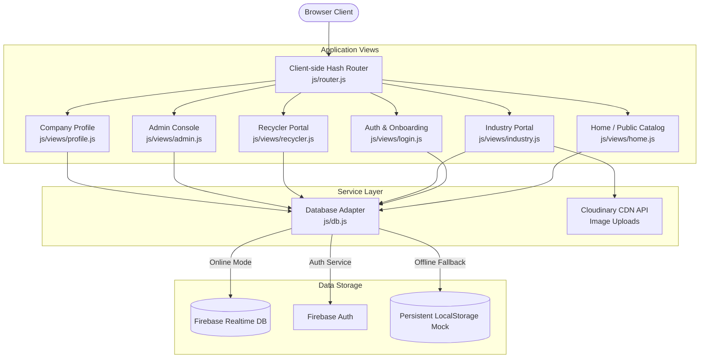

# ♻️ WasteBridge | B2B Circular Economy Platform

<div align="center">

[](LICENSE)
[](https://github.com/Royalp24/Wastebridge)
[](https://firebase.google.com/)
[](https://cloudinary.com/)
[](https://vercel.com/)

**Connecting Industrial Waste Generators with Verified Recycling Facilities**

*A secure, transparent, and compliant digital marketplace for industrial scrap, material diversion, and circular trade.*

[Explore Platform](#-platform-overview) •
[Architecture](#-system-architecture) •
[Key Features](#-core-features) •
[Getting Started](#-getting-started) •
[Configuration](#-configuration) •
[Deployment](#-deployment)

---

</div>

## 📌 Executive Summary

Modern industrial facilities generate millions of kilograms of recyclable production offcuts, packaging drums, scrap metals, and polymers daily. Traditional waste disposal channels are fragmented, opaque, and susceptible to regulatory compliance failures.

**WasteBridge** is a purpose-built B2B circular marketplace designed to bridge the operational gap between **Industrial Waste Generators** and **Certified Recyclers**. Through verified corporate identity checks, compliant bidding workflows, transparent material metrics, and real-time transaction tracking, WasteBridge diverts manufacturing scrap from landfills directly into verified secondary raw material supply chains.

---

## 🌟 Core Features

### 🏭 For Industrial Waste Generators
* **Direct Stream Publishing**: Post manufacturing scrap across 10 distinct material categories (Plastic, Metal, Paper, Glass, Rubber, E-Waste, Textile, Chemical, Organic, Wood).
* **Cloudinary Photo Uploads**: Instant image capture and CDN hosting with automated client-side fallbacks.
* **Granular Spec Sheets**: Document exact weights (in KGs), contamination tolerances, packaging formats (drums, bales, loose), and pickup coordinates.
* **Competitive Bids Manager**: Receive, review, and evaluate bids submitted by licensed recycling companies in real-time.
* **Listing Lifecycle Control**: Activate, review bids, accept deals, and delete obsolete listings directly from the management console.

### 🔄 For Certified Recyclers
* **Live Material Feed**: Browse real-time, categorized public scrap listings with instant keyword search and category filtering.
* **Quotation & Bidding Engine**: Submit binding volume-based price proposals (₹ INR) paired with logistical pickup timelines and terms.
* **Deal Procurement Pipeline**: Track submitted proposals through `pending`, `accepted`, and `rejected` statuses with mutual contact disclosure upon deal closure.
* **Procurement Analytics**: Visual Chart.js dashboards mapping material acquisition history and expenditure trends.

### 🛡️ Platform Administration & Compliance
* **KYC & Corporate Verification**: Role-based access control (RBAC) preventing unverified entities from transacting.
* **Corporate Tax & Permit Auditing**: Verification workflow capturing GSTIN tax identification numbers, plant addresses, and contact credentials.
* **Marketplace Moderation**: Administrative oversight across users, listings, and platform-wide diversion volumes.

---

## 🏛️ System Architecture

WasteBridge is engineered as a lightweight, zero-dependency **Single Page Application (SPA)** utilizing modern vanilla ES6 modules, custom reactive hash routing, and decoupled cloud service adapters.



---

## 💻 Tech Stack

| Domain | Technology | Description |
| :--- | :--- | :--- |
| **Frontend Core** | Vanilla HTML5 / ES6+ JavaScript | Zero-framework modular client-side architecture |
| **Design System** | Custom Vanilla CSS3 | Modern glassmorphism, fluid typography (`Outfit`, `Plus Jakarta Sans`), mobile-responsive grid |
| **Routing** | Custom Reactive Router | Client-side hash routing (`#home`, `#industry`, `#recycler`) with async role guards |
| **Authentication** | Firebase Authentication | Secure email/password authentication & session state listeners |
| **Database** | Firebase Realtime Database | Real-time JSON data tree with sub-second synchronization |
| **Fallback DB** | HTML5 LocalStorage | Seeded mock database for zero-config offline demonstration |
| **Image Hosting** | Cloudinary REST API | Unsigned direct image uploads with Base64 data-URI fallback |
| **Visualizations** | Chart.js | Interactive canvas charts for procurement metrics and bid statuses |
| **Notifications** | Toastify.js | Non-intrusive async user feedback notifications |
| **Iconography** | Font Awesome 6 | Unified enterprise UI iconography |

---

## 📂 Repository Structure

```text
Wastebridge/
├── assets/
│   └── hero_illustration.png      # High-resolution landing illustration
├── css/
│   └── styles.css                 # Unified CSS design tokens, components & responsive layout
├── js/
│   ├── app.js                     # Bootstrap controller, global error handlers & navbar sync
│   ├── db.js                      # Database adapter (Firebase RTDB + LocalStorage fallback)
│   ├── router.js                  # Client-side hash router with role & authentication guards
│   └── views/
│       ├── admin.js               # Administrator dashboard & moderation console
│       ├── home.js                # Public landing page, metrics strip & marketplace browser
│       ├── industry.js            # Industrial waste generator portal & Cloudinary uploader
│       ├── login.js               # Corporate sign-in & registration portal
│       ├── profile.js             # Company compliance & identity settings (GSTIN, Address)
│       └── recycler.js            # Recycler procurement portal & live bidding engine
├── index.html                     # Unified SPA mounting shell
├── vercel.json                    # Single-Page Application rewrite rules for Vercel
└── README.md                      # Technical documentation
```

---

## 🚀 Getting Started

### Prerequisites
To run the platform locally, you only need a standard modern web browser and any static HTTP server.

* Modern browser: **Chrome**, **Edge**, **Firefox**, or **Safari**
* Optional local runner: **Python 3.x** or **Node.js (npx serve / live-server)**

### 1. Clone the Repository
```bash
git clone https://github.com/Royalp24/Wastebridge.git
cd Wastebridge
```

### 2. Launch Local Development Server
Because WasteBridge utilizes ES6 modules (`import` / `export`), it must be served over an HTTP protocol rather than raw `file://`.

**Using Python 3:**
```bash
python -m http.server 5000
```

**Using Node.js:**
```bash
npx serve . -l 5000
```

Navigate to `http://localhost:5000` in your browser.

---

## ⚙️ Configuration

### Firebase Realtime Database
The platform is pre-wired to Firebase Realtime Database in `js/db.js`. Ensure your Firebase Security Rules are configured as follows:

```json
{
  "rules": {
    "users": {
      ".read": "auth != null",
      "$role": {
        "$uid": {
          ".write": "auth != null && (auth.uid === $uid || root.child('users/Admin').child(auth.uid).exists())"
        }
      }
    },
    "listings": {
      ".read": true,
      ".write": "auth != null"
    },
    "bids": {
      ".read": "auth != null",
      ".write": "auth != null"
    }
  }
}
```

### Cloudinary CDN Setup
Image uploads for waste listings are handled via unsigned presets in `js/views/industry.js`:

```javascript
const CLOUDINARY_CLOUD_NAME = "hl12nfti"; 
const CLOUDINARY_UPLOAD_PRESET = "wastebridge_preset";
```
*If Cloudinary credentials are not reachable or offline, the platform automatically falls back to client-side Base64 string encoding.*

---

## 🌐 Deployment

### Deploying to Vercel
1. Import the repository into your [Vercel Dashboard](https://vercel.com/).
2. Framework Preset: **Other**.
3. Root Directory: `./` (or leave default).
4. Deploy! The included `vercel.json` automatically handles routing all requests to `index.html`.

### Deploying to Render
1. Create a new service in your [Render Dashboard](https://render.com/).
2. **Select "Static Site"** *(Do NOT select "Web Service")*.
3. Build Command: *(Leave blank)*.
4. Publish Directory: `.`.
5. Click **Create Static Site**.

---

## 🔒 Security & Data Integrity

* **Role-Based Guards**: Protected routes (`#industry`, `#recycler`, `#admin`) strictly require authenticated sessions and verified roles before rendering view templates.
* **XSS Defense**: File-scoped `escapeHtml()` sanitization across all user-supplied input strings before injection into DOM templates.
* **Compliance Safeguards**: Pre-acceptance anonymization ensures company contacts and plant addresses are safeguarded until a transparent commercial deal is formally accepted.

---

## 📄 License
This project is open-source and available under the [MIT License](LICENSE).

<div align="center">
  <sub>Built with circular economy principles by the WasteBridge Team.</sub>
</div>
